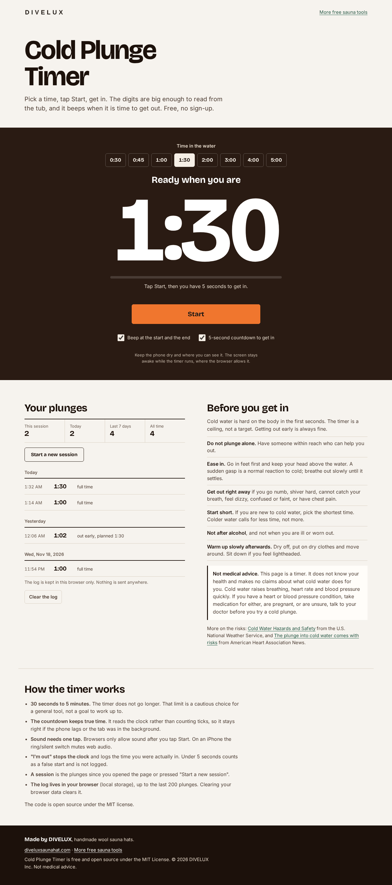
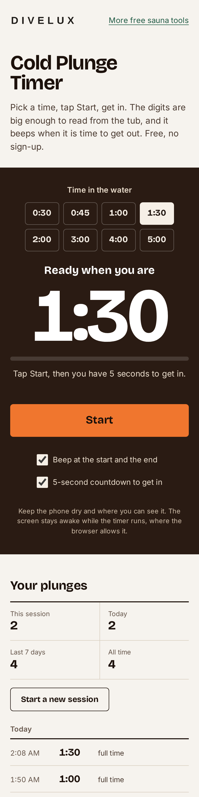

# Cold Plunge Timer

A free, open-source countdown timer for a cold plunge. Pick a time from 30 seconds to 5 minutes, tap Start, get in. The digits are big enough to read from the tub, it beeps when the time is up, counts your plunges for the session, and keeps a private log in the browser.

Made by [DIVELUX](https://diveluxsaunahat.com), a small family brand in Irvine, California that makes handmade wool sauna hats.





> **Not medical advice.** This is a timer. It makes no claims about what cold water does for you. Do not plunge alone, get out right away if you go numb, shiver hard or feel unwell, and talk to your doctor first if you have a heart or blood pressure condition, are pregnant, or are unsure.

## What it does

- Eight preset times: 0:30, 0:45, 1:00, 1:30, 2:00, 3:00, 4:00, 5:00. The timer does not go longer than 5 minutes, on purpose
- Very large countdown digits and a progress bar
- An optional 5-second "get in" countdown before the clock starts
- A beep at the start and a longer one at the end (Web Audio), vibration on phones that support it
- A screen wake lock while the timer runs, where the browser allows it
- "I'm out" stops the clock early and logs the time you were actually in
- Counts plunges for this session, today, the last 7 days and all time
- A log of the last 200 plunges kept in `localStorage`. Nothing leaves the browser. "Clear the log" asks before it deletes
- Remembers your last time and switches

No build step, no framework, no tracking, no cookies, no account. The only outside request is for two web fonts; if that fails the page uses system fonts.

## Run it

Open `index.html` in a browser. Or serve the folder:

```sh
python3 -m http.server 8000
# then open http://localhost:8000
```

To publish on GitHub Pages: push this folder to a repository, then Settings → Pages → Deploy from a branch → `main` / root. The `.nojekyll` file is already here. Before you publish under your own address, replace `https://divelux.github.io/cold-plunge-timer/` in `index.html`.

## Files

| File | What it is |
| --- | --- |
| `index.html` | The page: timer, log, safety notes, footer |
| `style.css` | All styles. Every class starts with `dvx-` or `cpt-` |
| `plunge.js` | Timing and log logic. Pure functions, no DOM and no storage. Works in Node too |
| `app.js` | The interface: buttons, sound, wake lock, storage |
| `test.js` | Checks the clock at every 100 ms of every preset, the log, and the page text |

## How it works

- **True time.** The clock reads `Date.now()` against the moment you tapped Start instead of counting ticks, so it stays right if the phone lags or the tab was in the background.
- **Sound needs one tap.** Browsers only allow sound after a tap, so the audio is set up when you press Start. On an iPhone the ring/silent switch mutes web audio.
- **Background tabs.** Phones pause timers in background tabs. The countdown catches up when you come back, but the beep can be late if the screen was off. Keep the page open; the wake lock helps where it is supported.
- **Early exit.** "I'm out" logs the seconds you were in. Under 5 seconds is treated as a false start and not logged.
- **Session.** The plunges since you opened the page or pressed "Start a new session" (kept in `sessionStorage`, so a reload does not lose the count).
- **Storage keys.** `dvx-cold-plunge-v1` (the log), `dvx-cold-plunge-prefs` (last time and switches), `dvx-cold-plunge-session` (session count). If storage is blocked, the timer still works and the page says the log will not be kept.

## Safety text

The page carries a short "Before you get in" list: do not plunge alone; ease in feet first with your head above water; get out right away if you go numb, shiver hard, cannot catch your breath, feel dizzy or have chest pain; start short; not after alcohol; warm up slowly afterwards. It links to two outside pages on the risks of cold water, both checked in November 2026:

- U.S. National Weather Service, [Cold Water Hazards and Safety](https://www.weather.gov/safety/coldwater)
- American Heart Association News, [You're not a polar bear: The plunge into cold water comes with risks](https://www.heart.org/en/news/2022/12/09/youre-not-a-polar-bear-the-plunge-into-cold-water-comes-with-risks) (2022)

If you fork this, please keep that text. `test.js` fails if the safety lines are removed or if health-claim wording is added to the page or this file.

## Use the logic in your own code

```js
const P = require('./plunge.js');
P.clampDuration(100);                       // 105 (15-second steps, 30 to 300)
P.phaseAt(start, Date.now(), 5, 90);        // { phase: 'getin' | 'plunge' | 'done', remainingSec, elapsedSec, progress }
const e = P.entry(start, 90, 62);           // { t, planned: 90, actual: 62, full: false }
const log = P.add(P.parse(storedText), e);  // new list, newest 200 kept
P.summarize(log, Date.now());               // { total, today, last7, secondsTotal, days: [...] }
```

## Tests

```sh
node test.js
```

## Credit and license

Made by [DIVELUX](https://diveluxsaunahat.com), handmade wool sauna hats. More free sauna tools: <https://diveluxsaunahat.com/pages/sauna-tools>

MIT License, © 2026 DIVELUX Inc. See [LICENSE](LICENSE).
